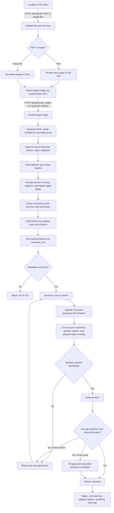

# Document Question Generator Backend

FastAPI backend for scanned PDF/image ingestion, OCR with word boxes, heuristic figure/map/diagram detection, caption exclusion, reading order, Gemini question generation, and source-grounding checks.

## Backend workflow



### What happens at each stage

1. **Upload:** `/api/upload` accepts PDF, PNG, and JPG files. PDFs are rendered one page at a time at 200 DPI. The response contains page image data URLs and page dimensions.
2. **OCR:** `/api/generate` runs Tesseract on each page. Small images are enlarged for OCR, and word boxes are mapped back to the uploaded image's pixel coordinates.
3. **Layout and exclusion:** OpenCV estimates visual regions. Nearby caption lines, text inside visual regions, and text clipped at the image edge are excluded from question-source text. Each exclusion is returned with a type, bounding box, and reason.
4. **Reading order:** Remaining OCR words are grouped into lines and blocks, then assembled into `extracted_text`. Activities are omitted unless requested.
5. **Question generation:** Gemini receives the retained text, not the page image. It returns schema-shaped questions of the requested types and difficulty.
6. **Grounding:** Pydantic and grounding checks validate the question fields, source sentence, answer, MCQ options, and overlap with excluded captions. Invalid candidates are retried; grounded templates can fill remaining gaps after retries.
7. **Response:** The API returns processed pages and OCR boxes, extracted text, skipped regions, questions, and warnings for the frontend to display.

## Requirements and setup

- Python 3.11
- Tesseract OCR executable installed (`PATH` or the standard Windows install path; set `TESSERACT_CMD` for a custom location)
- Gemini API key for question generation

```powershell
py -3.11 -m venv .venv
.venv\Scripts\Activate.ps1
pip install -r requirements.txt
Copy-Item .env.example .env
# Edit .env and set GEMINI_API_KEY
uvicorn app.main:app --reload
```

Health: `GET http://localhost:8000/health` (also reports whether a Gemini key is configured, never its value). Interactive OpenAPI: `http://localhost:8000/docs`.

## Frontend flow

### 1. Upload one or more documents

`POST /api/upload` as `multipart/form-data`, repeat the `files` field for multiple PDFs/JPGs/PNGs. PDFs are rendered page by page at 200 DPI. Maximum: 25 MB per file and 30 pages per request.

Response pages include `page_image_url` (base64 PNG data URL), `page_size` in pixels, `page_number`, and source metadata.

### 2. Generate questions and extracted page data

`POST /api/generate` with JSON:

```json
{
  "pages": [
    {
      "page_number": 1,
      "page_image_url": "data:image/png;base64,...",
      "page_size": {"width": 1654, "height": 2339, "unit": "px"}
    }
  ],
  "question_count": 8,
  "question_types": ["mcq", "short_answer", "true_false", "fill_blank"],
  "difficulty": "mixed",
  "include_activities": false
}
```

The response has the same top-level `pages` shape expected by the frontend, plus `extracted_text`, `skipped_regions`, `questions`, and warnings. Per-page output has `page_image_url`, pixel `page_size`, OCR `words` with bboxes/confidence/line ids, ordered `blocks`, `extracted_text`, `skipped_regions`, and `debug_overlay_url` for visual OCR/layout inspection. Accepted-confidence OCR words are retained in the response, including excluded words marked with `excluded` and `excluded_reason`.

Question fields: `type`, `question`, `options` (four items for MCQ), `answer`, `difficulty`, and verbatim `source_sentence`. The request's image is used for OCR/layout only. Gemini receives only the assembled retained text.

### Debug OCR

`POST /api/debug/ocr-overlay` accepts `page_image_url` as a form field and returns word boxes plus `debug_overlay_url`. The overlay draws retained word boxes in green, excluded word boxes in orange, and skipped regions in red.

## Processing details and limits

- OCR uses Tesseract `image_to_data`; confidence below 28 is dropped from content. Coordinates are pixel-relative to the returned page image.
- OpenCV combines color saturation and texture masks, contours, area thresholds, and OCR-word density to estimate visual regions. Types (`photo`, `map`, `diagram`) are heuristic. OCR words substantially inside detected regions are removed.
- Caption candidates are short lines adjacent to a visual region, with horizontal overlap and/or a figure-style prefix. Caption text is excluded and linked on the region as `caption`.
- Lines are grouped into paragraphs, sorted top-to-bottom and left-to-right, and split into columns when a wide gutter is detected. Larger lines, numbered headings, and all-caps lines are tagged as headings; “Do you know?” is a callout. Activity blocks are excluded by default and surfaced as optional skipped regions.
- Gemini structured output is validated through Pydantic. Invalid, ungrounded, caption-overlapping, or malformed MCQ candidates are rejected and generation is retried up to two additional times. Requested types are covered when the question count allows. If Gemini still misses a type or the requested count after retries, grounded extractive templates fill the gaps. Gemini calls have a 45-second SDK timeout and a 50-second async safety timeout per attempt.
- Layout and image detection are heuristics. Review page overlays, especially for dense maps, low-contrast diagrams, and two-column pages.

The phase-44 sample output is not included as real page data because the source textbook page was not present in the workspace. `sample_output.json` is a clearly labeled synthetic contract example; replace it with the response from the actual page-44 upload for submission.

## Deployment

### Deploy backend to Render

The included `Dockerfile` installs Tesseract OCR and the Python dependencies, then starts FastAPI on Render's assigned port.

1. Push the project to a GitHub repository and connect it to Render as a **Web Service**.
2. Select **Docker** as the runtime. Set the **Root Directory** to `ass-backend` (the folder containing this README and Dockerfile). If Render asks for a Dockerfile path relative to the repository root, use `ass-backend/Dockerfile`.
3. Add these environment variables in the Render service settings:
   - `GEMINI_API_KEY`: your Gemini key (never commit this secret).
   - `GEMINI_MODEL`: `gemini-3.5-flash-lite` (optional; the backend has a default).
   - `CORS_ORIGINS`: the exact deployed Lovable frontend origin, such as `https://your-project.lovable.app`.
4. Deploy, then check `https://<your-render-service>.onrender.com/health`. Expect `{"status":"ok","gemini_configured":true}`.
5. In the Lovable frontend environment settings, set `VITE_API_BASE_URL` to `https://<your-render-service>.onrender.com`, redeploy the frontend, and test a PDF at `/api/upload` followed by `/api/generate`.

Render builds Docker services from the configured Dockerfile and makes service environment variables available at runtime. See [Render Docker deploys](https://render.com/docs/docker) and [Render environment variables](https://render.com/docs/configure-environment-variables).
