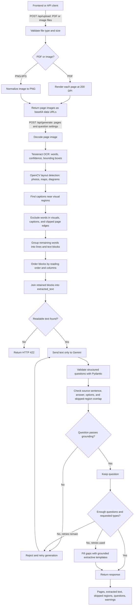

# Document Question Generator Backend

FastAPI backend for scanned PDF/image ingestion, OCR with word boxes, heuristic figure/map/diagram detection, caption exclusion, reading order, Gemini question generation, and source-grounding checks.

## Backend workflow



### What happens at each stage

1. **Upload:** `/api/upload` accepts PDF, PNG, and JPG files. PDFs are rendered one page at a time at 200 DPI. The response contains page image data URLs and page dimensions.
2. **OCR:** `/api/generate` runs Tesseract on each page. Small images are enlarged for OCR, and word boxes are mapped back to the uploaded image's pixel coordinates.
3. **Layout and exclusion:** OpenCV estimates visual regions. Nearby caption lines, text inside visual regions, and text clipped at the image edge are excluded from question-source text. Each exclusion is returned with a type, bounding box, and reason.
4. **Reading order:** Remaining OCR words are grouped into lines and blocks, then assembled into `extracted_text`. Activity blocks are omitted when OCR recognizes the activity heading; a split or missed heading can leave activity text in the output.
5. **Question generation:** Gemini receives the retained text, not the page image. It returns schema-shaped questions of the requested types and difficulty.
6. **Grounding:** The normalized source sentence must match a retained text sentence; question terms must occur in the retained text; answer terms must occur in the cited sentence; MCQ options must be four distinct values found in the retained text. Caption-only terms are rejected. True/false candidates are accepted only when they repeat their source sentence and answer `True`; semantic entailment is not checked.
7. **Response:** The API returns processed pages and OCR boxes, extracted text, skipped regions, questions, and warnings for the frontend to display.

## Requirements and setup

- Python 3.11
- Tesseract OCR executable installed (`PATH` or the standard Windows install path; set `TESSERACT_CMD` for a custom location)
- Gemini API key for question generation

```powershell
py -3.11 -m venv .venv
.venv\Scripts\Activate.ps1
pip install -r requirements.txt
Copy-Item .env.example .env
# Edit .env and set GEMINI_API_KEY
uvicorn app.main:app --reload
```

Health: `GET http://localhost:8000/health` (also reports whether a Gemini key is configured, never its value). Interactive OpenAPI: `http://localhost:8000/docs`.

For local frontend development, set `VITE_API_BASE_URL=http://localhost:8000` in `ass-frontend/.env`. The frontend variable belongs to the Vite app; the backend `.env` is for `GEMINI_API_KEY`, `GEMINI_MODEL`, and `CORS_ORIGINS`.

## Frontend flow

### 1. Upload one or more documents

`POST /api/upload` as `multipart/form-data`, repeat the `files` field for multiple PDFs/JPGs/PNGs. PDFs are rendered page by page at 200 DPI. Limits: 25 MB per file, 30 pages total per request, 40 megapixels per image, and 60 MB total rendered page data.

Response pages include `page_image_url` (base64 PNG data URL), `page_size` in pixels, `page_number`, and source metadata.

### 2. Generate questions and extracted page data

`POST /api/generate` with JSON:

```json
{
  "pages": [
    {
      "page_number": 1,
      "page_image_url": "data:image/png;base64,...",
      "page_size": {"width": 1654, "height": 2339, "unit": "px"}
    }
  ],
  "question_count": 8,
  "question_types": ["mcq", "short_answer", "true_false", "fill_blank"],
  "difficulty": "mixed",
  "include_activities": false
}
```

The response has the same top-level `pages` shape expected by the frontend, plus `extracted_text`, `skipped_regions`, `questions`, and warnings. Per-page output has `page_image_url`, pixel `page_size`, OCR `words` with bboxes/confidence/line ids, ordered `blocks`, `extracted_text`, `skipped_regions`, and `debug_overlay_url` for visual OCR/layout inspection. Accepted-confidence OCR words are retained in the response, including excluded words marked with `excluded` and `excluded_reason`.

Question fields: `type`, `question`, `options` (four items for MCQ), `answer`, `difficulty`, and verbatim `source_sentence`. Deterministic checks require answer terms to appear in the cited sentence and question/option terms to appear in extracted text. True/false items are restricted to exact source sentences marked True; the backend does not claim semantic verification of arbitrary false statements. The request's image is used for OCR/layout only. Gemini receives only the assembled retained text.

### Debug OCR

`POST /api/debug/ocr-overlay` accepts `page_image_url` as a form field and returns word boxes plus `debug_overlay_url`. The overlay draws retained word boxes in green, excluded word boxes in orange, and skipped regions in red.

## Processing details and limits

- **OCR:** Tesseract `image_to_data` drops words below confidence 28. Images narrower than 1,200 pixels are upscaled (up to 3×) for OCR, then word boxes are mapped back to original-image coordinates. OCR confidence is a filter, not a guarantee of correct spelling.
- **Visual detection:** OpenCV proposes regions from saturation and local texture, then applies size, fill, OCR-density, and shape heuristics. `photo`, `map`, and `diagram` labels are estimates; this is not a trained layout model. Detected-region word boxes are excluded from body text.
- **Captions:** Short OCR lines near and horizontally aligned with a detected visual may be linked as captions and excluded. When Tesseract joins a caption and body text on one line, the backend attempts to keep only words in the figure's horizontal span. This can still miss small captions or attach nearby prose.
- **Reading order:** Tesseract lines are grouped into blocks with a simple wide-gutter column split. Headings and “Do you know?” callouts use text-pattern/font-size heuristics. Activity exclusion relies on recognizing an OCR line beginning with “Activity”; wrapped or badly recognized labels and instructions can remain in the extracted text.
- **Question validation:** Gemini receives retained text only. Pydantic checks the response shape; the grounding check verifies that the cited source sentence occurs in retained text, checks answer terms and MCQ structure, and blocks terms found only in skipped captions. This is a lexical check: it does not prove a true/false statement is factually true, nor prove MCQ distractors are semantically unambiguous. The prompt asks Gemini to satisfy those quality rules; grounded templates can fill gaps after up to three Gemini attempts and may be less natural.
- **Timing:** The Gemini SDK timeout is 45 seconds and each async attempt has a 50-second limit; the generator can make up to three attempts. A slow request may therefore take a long time. A timeout in `asyncio.to_thread` does not stop the underlying synchronous worker thread immediately.

### Accuracy check against the supplied page image

This is a one-image smoke check, not a benchmark across textbook layouts. On the supplied 554 × 936 page image, OCR returned 276 words; 248 remained after visual/caption exclusions, producing 1,419 characters across 8 blocks. The detector returned the four main visual panels (three photos and one map). It linked the glacier and dam captions; the small Ganga-plains caption was not recovered. The introduction and main river paragraphs were retained in reading order, but some activity text remained and OCR split “Activity” across a line. Question generation was not confirmed in this run because the Gemini request did not return during the check window.

| Assignment criterion | Weight | Current evidence and limitation |
| --- | ---: | --- |
| Images, maps, diagrams, and captions excluded | 25% | Four main visual panels detected on the supplied page. One of three photo captions was missed; heuristic regions need review on other pages. |
| Text extraction and reading order | 20% | Main page sections appeared in order in the smoke check. Small caption and activity text were imperfect. |
| Question quality, variety, difficulty, and answer key | 25% | Structured schema and extractive fallback exist. A completed Gemini question-set review has not been recorded, so quality is not claimed as validated. |
| Grounding in extracted text | 15% | Source-text lexical checks are implemented and a caption/body overlap rejection bug was corrected. This does not establish semantic correctness. |
| Code, docs, UI, and JSON usability | 15% | API schemas, sample JSON, docs, and frontend integration exist. The sample JSON is synthetic; full production build/deployment must be checked in the target environment. |

`sample_output.json` is a synthetic contract example, not output from this page or a verified Gemini run. Replace it with a real API response before using it as a submission sample.

## Deployment

### Deploy backend to Render

The included `Dockerfile` installs Tesseract OCR and the Python dependencies, then starts FastAPI on Render's assigned port.

1. Push the project to a GitHub repository and connect it to Render as a **Web Service**.
2. Select **Docker** as the runtime. Set the **Root Directory** to `ass-backend` (the folder containing this README and Dockerfile). If Render asks for a Dockerfile path relative to the repository root, use `ass-backend/Dockerfile`.
3. Add these environment variables in the Render service settings:
   - `GEMINI_API_KEY`: your Gemini key (never commit this secret).
   - `GEMINI_MODEL`: `gemini-3.5-flash-lite` (optional; the backend has a default).
   - `CORS_ORIGINS`: the exact deployed frontend origin, such as `https://assignment-f-five.vercel.app`.
4. Deploy, then check `https://<your-render-service>.onrender.com/health`. Expect `{"status":"ok","gemini_configured":true}`.
5. In the Vercel frontend environment settings, set `VITE_API_BASE_URL` to `https://<your-render-service>.onrender.com`, redeploy the frontend, and test a PDF at `/api/upload` followed by `/api/generate`.

Render builds Docker services from the configured Dockerfile and makes service environment variables available at runtime. See [Render Docker deploys](https://render.com/docs/docker) and [Render environment variables](https://render.com/docs/configure-environment-variables).
